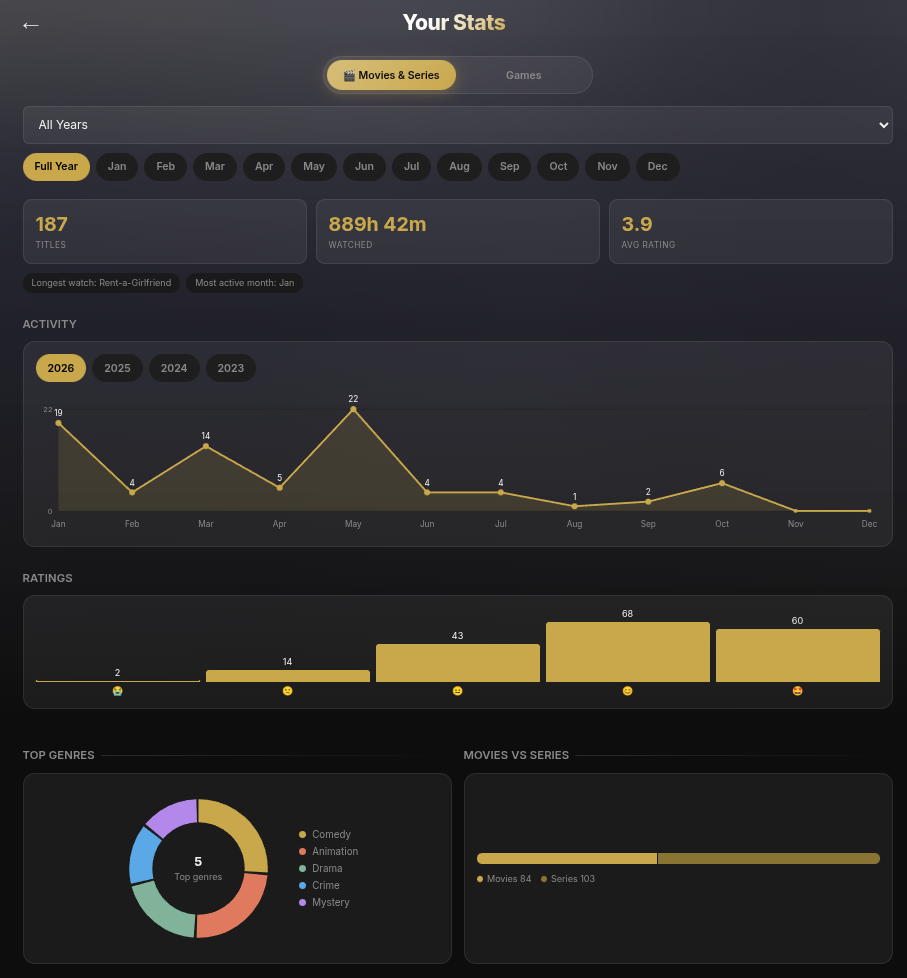

# 🎬 Playlog

A personal movie, web series, game, and **book** tracking Progressive Web App (PWA). Track what you watch, play, and read; organize your media; and explore separate stats and Wrapped cards for movies/series, games, and books.

**Live:** [Playlog-pwa.vercel.app](https://moviebase-pwa.vercel.app)

---

## What It Does

- Search any movie or web series via TMDB, or any game via RAWG, and add it to your collection
- Search for books via Open Library and manage them on dedicated reading shelves
- For series, pick a specific season with its own poster
- Import mixed movie and series title lists (up to 100 titles) from a `.txt` file, review TMDB matches, and add watched entries or an unwatched Watchlist
- Track books as Want to Read, Reading, or Read, including reading dates, pages, ratings, and reviews
- Rate movies/series with a 5-emoji scale (😭 🙁 😐 😊 🤩); rate games on a 1–10 scale
- Track game status — Wishlist, Currently Playing, Completed, Dropped — each with its own auto-created playlist
- Log hours played per game, editable any time
- Organize everything into named playlists, with a custom cover image per playlist
- A dedicated Games tab throughout the app (Home, Stats, Wrapped Card) — completely separate metrics from Movies & Series
- A dedicated Books page with a searchable library, reading statistics, and a downloadable Books Wrapped card
- Tap any title for a full detail page with everything you logged
- Move an entry between playlists, or delete it, from its detail page
- Generate a shareable image card for a single entry, an entire playlist (poster grid), or a full Wrapped recap
- Filter, sort, and view stats by year and month — years shown are generated dynamically from your own data
- Install directly from Chrome as a native-like app (PWA)
- Fully synced across all your devices via Firebase
- Backup & Restore (download everything as a JSON file, restore into any account) with optional weekly or monthly auto-backup
- Rewatch counter for movies and series (rewatches add to watch time)
- Wishlist games are excluded from stats and ask for full details when moved to Completed, Playing or Dropped
- Drag-to-reorder playlists (hold, then drag)
- Search and sort inside a playlist
- Edit rating, date, hours, rewatches and review from the entry page
- Undo for deleted entries
- Dark and light themes plus accent colour (Settings)
- Mobile navigation for Movies, Games, and Books
- One-time "What's New" card for each release

---

## Tech Stack

| Layer | Tool |
|---|---|
| Frontend | Vanilla HTML, CSS, JavaScript |
| Database | Firebase Firestore |
| Auth | Firebase Authentication (Google Sign-In) |
| Movie/Series Data | TMDB API |
| Game Data | RAWG API |
| Book Data | Open Library API |
| Hosting | Vercel |
| PWA | Web App Manifest + Service Worker (network-first for app files) |
| Stats/Share Cards | HTML Canvas API |
| Image proxy | images.weserv.nl (adds CORS headers so RAWG posters can be drawn to canvas) |

No frameworks. No npm. No build step. Pure static files.

---

## Features

**Core**
- Google Sign-In (with account picker forced, so switching accounts always works) — your data is private and tied to your account
- Search movies and TV series with live TMDB results, or games with live RAWG results
- Category/genre for games is auto-fetched — no manual tagging
- Season-level tracking for series (separate entry per season)
- Emoji rating system for movies/series: 😭 🙁 😐 😊 🤩
- 1–10 numeric rating system for games
- Month tagging for every movie/series entry — future months are blocked
- Duplicate detection — searching for something you've already logged shows an inline "✓ Already added" tag

**Books**
- Search Open Library and add books to the **Want to Read**, **Reading**, or **Read** shelf
- Track author, cover, genres, fiction/non-fiction type, page count, start and finish dates, rating, and review
- Move books between shelves, edit details, search and sort the library, and switch between grid and list views
- View reading stats by year and month, including reading pace, books and pages read, ratings, page counts, and top genres
- See Open Library community ratings for books on the Want to Read shelf
- Generate a downloadable Books Wrapped card in detailed or aesthetic style
- Upload a plain-text list of book titles to add multiple books

**Games — status-driven flow**
- Choosing **Wishlist** skips rating entirely and auto-creates/uses a "Wishlist" playlist
- Choosing **Currently Playing** skips rating, auto-selects the current month/year, and auto-creates/uses a "Currently Playing" playlist
- Choosing **Dropped** asks for an optional reason
- Choosing **Completed** asks for rating, hours played, and review — and auto-creates/uses a "Completed Games" playlist
- Editing a "Currently Playing" game offers a one-tap "Have you completed this game?" flow — checking it asks for a rating/review and moves the entry straight into Completed Games
- Editing a game never shows the movie-only "Month Watched" field

**Organization**
- Create, rename, or delete playlists (deleting also removes its entries)
- Set a custom cover image per playlist (client-resized before upload)
- Grid view with posters inside each playlist, or a flat "all entries, newest first" view — toggle between them, defaulting to flat
- Mini poster collage preview on playlist cards
- A Movies & Series playlist only ever offers Movie/Series search and filters; a Games playlist only ever offers Games — no cross-contamination
- Sort/filter entries by type inside a playlist
- Move any entry to a different (same-type) playlist from its detail page
- Delete an entry or edit its rating, month, hours played (games), or review after adding
- Tap any poster to open a full entry detail page (title, rating, runtime/playtime, genre, status, review, move/delete/share actions)

**Home**
- A top-level Movies & Series / Games pill switch — persisted in the URL so refreshing keeps your tab
- Stat cards (Total, Hours/Days, This Month, Completed/Movies·Series) that adapt entirely to the active tab
- Year filter generated dynamically from your own logged years — defaults to "All"
- A rotating fun-fact banner, tab-aware ("watched" vs "played", 5-star vs 8+/10, etc.)

**Stats — fully separated by tab**
- Movies & Series and Games each get their own complete stat grid, , deep cuts, and top picks — nothing bleeds between tabs
- Games get: games logged, hours played, completed, currently playing, dropped, wishlist, top genre, average rating (/10), most active month, longest single session
- Movies & Series get: titles watched, watch time, movies, series seasons, top genre, average rating, most active month, longest watch, best month (avg rating), completion rate
- A visual Playtime Leaderboard (top 5 by hours, medal-styled) for games
- Year dropdown includes "All Years" and defaults to it; month chips filter within a year
- "Your Picks" and "Deep Cuts" only show for Movies & Series (they're not meaningful stats for games)

**Wrapped Card**
- Generates a 1080×1920 downloadable image, fully respecting whatever year/month/tab is currently selected on the Stats page
- A fanned poster hero strip up top, fading into a clean data panel with a 3×2 stat grid, a Top Pick section with a real poster thumbnail, and a status/genre pill
- Purple accent for Games, gold accent for Movies & Series
- Books has a separate downloadable Wrapped card on the Books page

**Sharing**
- Share a single entry as a poster-background image card
- Share an entire playlist as a responsive poster grid (auto-sizes tiles based on how many entries you have) with title labels
- All share cards route poster images through a CORS-safe proxy so RAWG posters always render correctly, instead of failing silently

**PWA**
- Installable from Chrome on Android and desktop
- Runs in standalone mode (no browser bar)
- Network-first service worker for app files (always fetches the latest JS/CSS when online, falls back to cache only when offline) — no more stale cached bugs during development
- App shell + core routes precached for offline support

---

## Project Structure

```
/
├── index.html          # Login screen
├── home.html            # Dashboard — stats + playlists, Movies/Games tab
├── books.html           # Book library, reading shelves, stats, and Books Wrapped
├── playlist.html        # Individual playlist grid/flat view
├── add.html             # Add entry flow (search → season/status → rate)
├── stats.html            # Stats + Wrapped card, Movies/Games tab
├── entry.html            # Single entry detail page + edit
├── account.html          # Settings, theme, backup/restore
├── manifest.json         # PWA manifest
├── sw.js                 # Service Worker (network-first)
├── css/
│   ├── main.css          # Shared stylesheet
│   └── books.css         # Book library and reading stats styles
├── js/
│   ├── config.js          # Firebase + TMDB + RAWG config (not committed)
│   ├── firebase-init.js
│   ├── auth.js
│   ├── firestore.js
│   ├── tmdb.js
│   ├── rawg.js
│   ├── utils.js
│   ├── home.js
│   ├── playlist.js
│   ├── add.js
│   ├── media-import.js     # Bulk movie and series TXT import
│   ├── openlibrary.js     # Open Library search and book metadata
│   ├── books.js           # Book shelves, library, stats, and Books Wrapped
│   ├── stats.js
│   ├── entry.js
│   ├── account.js         # Settings page logic
│   ├── flow.js            # Rewatch prompt, wishlist-move form, undo delete
│   ├── backup.js          # Backup / restore / auto-backup
│   └── whatsnew.js        # One-time release popups (edit RELEASES array)
├── css/theme.css          # Light theme, accent colour, navigation
└── assets/
    └── icons/
```

---

## Setup (Self-Hosting)

### 1. Clone the repo

```bash
git clone https://github.com/Vishwajeeet/Playlog-pwa.git
cd Playlog-pwa
```

### 2. Create your config file

Create `js/config.js` (this file is gitignored):

```js
const APP_CONFIG = {
  firebase: {
    apiKey: "YOUR_FIREBASE_API_KEY",
    authDomain: "YOUR_PROJECT.firebaseapp.com",
    projectId: "YOUR_PROJECT_ID",
    storageBucket: "YOUR_PROJECT.appspot.com",
    messagingSenderId: "YOUR_SENDER_ID",
    appId: "YOUR_APP_ID"
  },
  tmdb: {
    key: "YOUR_TMDB_API_KEY",
    baseUrl: "https://api.themoviedb.org/3",
    posterBase: "https://image.tmdb.org/t/p/w500"
  },
  rawg: {
    key: "YOUR_RAWG_API_KEY",
    baseUrl: "https://api.rawg.io/api"
  }
};
```

### 3. Firebase setup

- Create a project at [console.firebase.google.com](https://console.firebase.google.com)
- Enable **Firestore Database** (production mode, region: asia-south1)
- Enable **Authentication** → Google Sign-In
- Set Firestore security rules:

```
rules_version = '2';
service cloud.firestore {
  match /databases/{database}/documents {
    match /users/{userId}/{document=**} {
      allow read, write: if request.auth != null
        && request.auth.uid == userId;
    }
  }
}
```

### 4. TMDB API key

- Create a free account at [themoviedb.org](https://www.themoviedb.org)
- Go to Settings → API → Create (Developer)
- Copy the v3 API key

### 5. RAWG API key

- Create a free account at [rawg.io](https://rawg.io/apidocs)
- Copy your API key from the dashboard

Books use the public Open Library API and do not require an API key.

### 6. Run locally

Open with [Live Server](https://marketplace.visualstudio.com/items?itemName=ritwickdey.LiveServer) in VS Code. Do not open as a plain file — Firebase Auth requires HTTP.

### 7. Deploy

Push to GitHub and connect to [Vercel](https://vercel.com). Set framework preset to **Other**, leave build command empty.

After deploying, add your Vercel URL to Firebase → Authentication → Authorized Domains.

---

## Data Model

All data lives under `users/{uid}/` in Firestore.

**Playlist document:**
```
name: string
type: "media" | "game"
coverImage: string (base64 data URL) | null
createdAt: timestamp
updatedAt: timestamp
```

**Entry document (movie/series):**
```
playlistId: string
tmdbId: number
title: string
type: "movie" | "series"
season: number | null
seasonName: string | null
poster: string (TMDB path)
releaseYear: number
runtime: number (minutes)
genres: string[]
monthWatched: number (1–12)
yearWatched: number
rating: number (1–5)
review: string | null
addedAt: timestamp
```

**Entry document (game):**
```
playlistId: string
rawgId: number
title: string
type: "game"
poster: string (full URL)
releaseYear: number
genres: string[]
category: string | null (auto-fetched genre)
completionStatus: "wishlist" | "playing" | "completed" | "dropped"
gameRating: number (1–10) | null
playtime: number (hours) | null
monthWatched: number (1–12) | null
yearWatched: number | null
dropReason: string | null
review: string | null
addedAt: timestamp
```

**Entry document (book):**
```
type: "book"
title: string
author: string
poster: string (Open Library cover URL) | null
pages: number | null
genres: string[]
fiction: boolean
olKey: string | null (Open Library work key)
bookStatus: "want" | "reading" | "read"
bookRating: number (1–10) | null
review: string | null
startDate: string (YYYY-MM-DD) | null
finishDate: string (YYYY-MM-DD) | null
finishMonth: number (1–12) | null
finishYear: number | null
openLibraryRating: { average: number, count: number } | null
openLibraryRatingFetched: boolean
playlistId: null
addedAt: timestamp
```

---

## Extra Data

- `users/{uid}/covers/{playlistId}`: `{ data: base64 }`. Playlist covers live in their own collection so playlist lists stay small. Old inline covers migrate automatically.
- `users/{uid}/settings/prefs`: tab, layout, avatar, theme, accent, autoBackup, lastBackup, lastSeenRelease.
- Entry extras: `rewatchCount`. Playlist extra: `order`.
- Entries are cached in `localStorage` for 5 minutes and cleared on every write. Use Settings → Refresh data after editing on another device.
- All user text is HTML-escaped on render (`AppUtils.esc`), and restore sanitizes numeric and poster fields.
- Security rules: keep only the owner-only rule above. Never use test mode.

## Why Firebase Free Tier Works Forever

| Resource | Free Limit | Estimated Usage |
|---|---|---|
| Storage | 1 GB | ~10–20 MB over 10 years (cover images are resized client-side before upload) |
| Reads/day | 50,000 | ~200–500 per session |
| Writes/day | 20,000 | ~5–10 per day |

This app will never hit Firebase's free tier limits.

---

## Screenshots

### Home Dashboard


### Playlist View


### Add Movie / Series / Game


### Stats & Wrapped Card


---

## License

Personal use. Not open for contributions.
