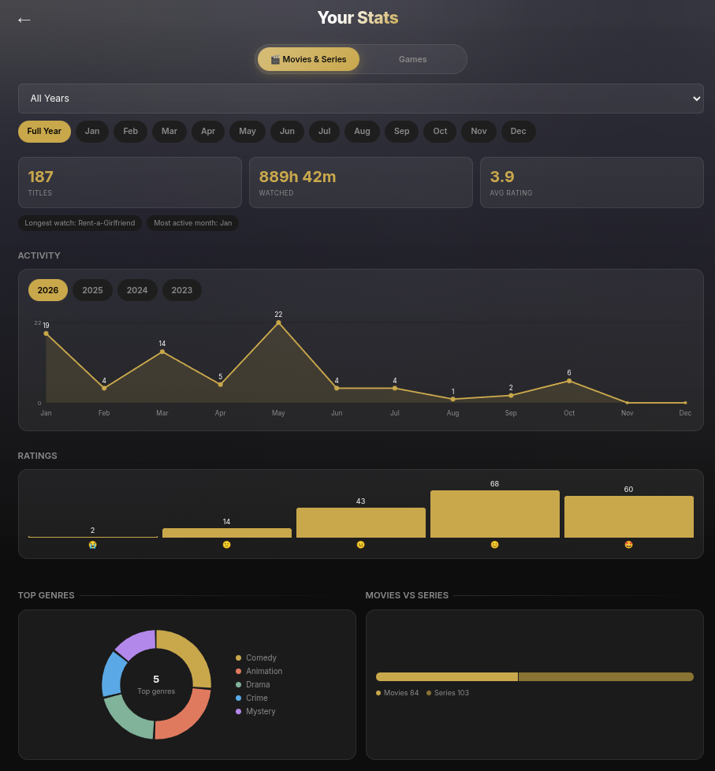

# Playlog

Playlog is a personal media diary for tracking movies, series, games, and books. Organize your collection, record ratings and progress, and explore activity stats and downloadable Wrapped cards.

**Live app:** [moviebase-pwa.vercel.app](https://moviebase-pwa.vercel.app)

## Features

- Search and track titles with TMDB, IGDB, or Open Library.
- Organize movies and series into playlists; track games by status and books by reading shelf.
- Record ratings, dates, reviews, and game playtime or book reading details.
- Explore separate statistics and downloadable Wrapped cards for media, games, and books.
- Sync your library across devices with Firebase; install Playlog as a Progressive Web App.
- Customize the app with themes, and back up or restore your data.

## Built with

Vanilla HTML, CSS, and JavaScript; Firebase Authentication and Firestore; TMDB, IGDB, and Open Library APIs; hosted on Vercel. The app has no build step.

## Self-hosting

1. Clone the repository and configure Firebase Authentication (Google Sign-In) and Firestore.
2. Set Firebase and TMDB values in `js/config.js`.
3. Configure `IGDB_CLIENT_ID` and `IGDB_CLIENT_SECRET` as Vercel environment variables for the server-side IGDB function.
4. Deploy the project to Vercel with no build command. Add the deployed domain to Firebase Authentication's authorized domains.

Use owner-scoped Firestore security rules so each signed-in user can access only their own data. Books use Open Library and do not require an API key.

## Screenshots

| Home | Playlists | Stats |
|---|---|---|
|  |  |  |

## License

Personal use. Contributions are not accepted.
